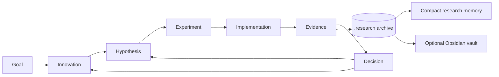

# ResearchLedger

**Innovation-Driven Research Management for Coding Agents**

[](https://github.com/FaFaGPT/ResearchLedger/actions/workflows/tests.yml)
[Download v0.1.0](https://github.com/FaFaGPT/ResearchLedger/releases/tag/v0.1.0)

Keep the scientific question in view as experiments, code changes and conversations accumulate. ResearchLedger is a working Codex Skill and zero-dependency Python CLI that connects research innovations to contracts, implementation evidence and explicit scientific decisions.

**Innovation-driven · Evidence-grounded · Method-transparent · Boundary-aware · Context-efficient · Knowledge-connected**



## What works in V1

- Three innovation origins, stable IDs, full revisions, approval, pause, rejection, split, replacement and primary-direction control.
- Validated contracts with pinned source/config bytes, paired comparisons, budgets, executable stops and duplicate detection.
- Opt-in execution with captured Git state, source/config blobs, Python function locations, logs, results and source diffs.
- Separate execution success, metric improvement, contract acceptance, structural verification and researcher decisions.
- Detection of unauthorized file changes, config/report mismatch, unfair comparisons and declarative innovation drift.
- Append-only, hash-chained transactions and immutable SHA-256 evidence; compact state rebuilt across conversations.
- Strict, Bounded and budgeted Explore policies. Exploratory results cannot directly become confirmatory conclusions.
- Optional Obsidian Dashboard, Properties, Bases tables, graph links, existing literature links and candidate-note import.
- Incremental sync with ownership hashes, conflict detection, interrupted-write recovery and manual-note protection.

Obsidian, MLflow, W&B and DVC are **not required**. ResearchLedger complements existing trackers with scientific intent and decisions; see [prior art](docs/RESEARCH.md) and the [adapter boundary](docs/ADAPTERS.md).

## Install

Requires Python 3.8+; use a supported Python release for new installations. Git is recommended for provenance and required for Explore branch checks. There are no runtime Python packages to download.

### Codex Skill

Get the source from the [public repository](https://github.com/FaFaGPT/ResearchLedger):

```bash
git clone https://github.com/FaFaGPT/ResearchLedger.git
cd ResearchLedger
```

From the repository directory, install into a project you choose:

```bash
python tools/install_skill.py --destination /path/to/project/.agents/skills
```

Windows PowerShell:

```powershell
python tools/install_skill.py --destination "D:/Research/MyProject/.agents/skills"
```

The installer creates `researchledger/` and refuses to overwrite an existing installation. For personal installation, pass your chosen user skill directory, such as `~/.agents/skills`. Some Codex distributions also use `$CODEX_HOME/skills`; use the location recognized by your installation. No global settings or AGENTS.md changes are made. [Official Codex skill discovery documentation](https://developers.openai.com/codex/skills).

Then invoke:

```text
Use $researchledger to resume this project, show which innovations have
evidence, and plan the next experiment within my approved research scope.
```

中文示例：`使用 $researchledger 恢复科研状态，检查失败路线，并为核心创新点规划下一个实验。`

### CLI

Run directly without installation:

```bash
python skills/researchledger/scripts/ledger.py --help
```

Or install the package in your environment:

```bash
python -m pip install .
researchledger --help
```

The CLI package and the self-contained Skill use the same source. Global options (`--project`, `--actor`, `--details`) go **before** the subcommand.

## Run a real experiment in one command

```bash
python tools/build_demo.py --output /path/to/new-demo
```

This explicitly requested demo creates a new project and runs a small CPU-only robust-estimation experiment: median versus mean on paired contaminated samples. It then creates failure and drift examples, captures evidence, saves a research checkpoint and exports an Obsidian vault. It refuses an existing destination and does not run expensive training. The example demonstrates management and audit behavior, not a novel scientific result.

Explore the included [example project](examples/demo/) and [Obsidian example vault](examples/demo/vault/). Open the vault in Obsidian and navigate to `ResearchLedger-Demo/Dashboard.md`. The [use cases](docs/USE_CASES.md) explain success, failure, drift and resumption. This is generated from actual runs, not fabricated metric output.

## Five core commands

| Command | Purpose | Writes? |
| --- | --- | --- |
| `status` | Goal, innovations, results, unresolved questions | No |
| `plan contract.json` | Validate and register a hypothesis and pinned experiment | Yes |
| `audit EXP-ID` | Verify evidence, fairness, deviations and drift | No; `--save` appends |
| `history TERM-OR-ID` | Search all revisions; `--details` expands records | No |
| `resume` | Rebuild compact research state from the journal | No |

`run EXP-ID` is a preflight only. `run EXP-ID --execute` launches the already-authorized command. Experiments are never launched by status, resume or Obsidian sync.

### Typical workflow

Use `researchledger --project PROJECT` before each command below, or the bundled `ledger.py` entrypoint:

```text
init "Reduce estimation error under sparse contamination"
--actor researcher innovation add innovation.json
--actor researcher innovation approve INN-ID --reason "Approved research direction"
plan contract.json
--actor researcher approve EXP-ID --reason "Approved command, scope and 10-second budget"
run EXP-ID
run EXP-ID --execute
audit EXP-ID
--details history EXP-ID
--actor researcher decision EXP-ID Supported --reason "Evidence supports this scoped hypothesis" --review review.md
resume
```

Use actual IDs printed by creation commands. Start from the [contract template](skills/researchledger/assets/contract.json) and [innovation example](examples/robust-location/innovation.json). The complete [workflow/schema reference](skills/researchledger/references/workflow.md) explains fields and transitions.

`--actor researcher` is an attribution of authorization already received from a researcher. It is **not authentication**, and an agent must never use it to authorize itself. The Skill enforces this workflow convention; anyone with write access to the local project can bypass local software controls.

## Evidence, not metric storytelling

Experiments supply `observed` configuration and paired baseline/treatment `trials` through a unique `RESEARCHLEDGER_RESULT` path. The runner captures their original bytes. The [audit protocol](skills/researchledger/references/audit.md) describes the required schema.

| Observation | Scientific meaning |
| --- | --- |
| Process exited successfully | Execution succeeded |
| Mean paired metric improved | Numerical improvement in the reported comparison |
| Audit is Completed | The implemented structural checks passed |
| Researcher accepted reviewed evidence | A scoped hypothesis may be Supported or Refuted |

Audit outcomes are Completed, Failed, Deviated and Unverified. A detected violation takes precedence over a failed run; each fact is retained separately. Missing facts remain Unknown. Formal conclusions require a verified confirmatory audit plus a pinned researcher review artifact. Results never automatically turn into scientific conclusions.

## Optional Obsidian integration

```bash
researchledger --project PROJECT obsidian init /path/to/vault
researchledger --project PROJECT obsidian status
researchledger --project PROJECT obsidian sync
```

The generated namespace contains Dashboard, Innovations, Experiments, Methods, Evidence, Decisions, Literature and Research State, with stable-ID wikilinks. `Research.base` offers native filtered table views. Obsidian Graph View reads the same links. Existing notes remain where they are:

```text
literature "Paper on robust statistics" "note:Reading/Robust Statistics.md" --innovations INN-ID
obsidian candidate Ideas/New-method.md
```

Candidates enter PendingReview and cannot overwrite official records. Manually editing a generated note blocks its replacement. Keep personal annotations in separate notes linking to generated IDs. Sync never deletes notes or offers a force-overwrite flag. See [sync guarantees](skills/researchledger/references/obsidian.md).

## Persistence and boundaries

```text
project/
  .research/
    events.jsonl       # append-only full record revisions + hash chain
    blobs/<sha256>     # captured immutable evidence
    runs/<run-ID>/     # unique raw process outputs
    state.json         # derived compact cache
    STATE.md           # derived human-readable memory
```

The ledger is the only formal source. Obsidian is a projection; caches are never trusted during reads. Back up the entire `.research/` directory together. A corrupt/truncated journal fails closed. There is no silent repair, deletion or rewriting of history.

V1 is a **cooperative local execution controller**, not a hostile-code sandbox. It enforces wall-time and captured-output limits, records workspace changes, and checks declared scientific invariants. It does not hard-limit GPU/RAM/spending/network, prevent every external side effect, authenticate users or prove that self-reported configuration was actually used. Detached descendants may escape process-tree cleanup on some platforms. Use OS/container/scheduler isolation for stronger limits.

The workspace snapshot is capped at 256 MiB / 20,000 files; `.git`, `.research`, `.venv`, `node_modules` and `__pycache__` are excluded. Declared inputs are capped at 16 MiB each. Large research projects should use a small dedicated execution worktree with reviewed data manifests. Only explicitly declared code/config inputs have full byte provenance; other files are change-hashed. Environment capture records Python/platform and explicitly listed dependency locks, not a complete machine image.

Current drift detection uses declared invariant keys plus file/config/report checks. Arbitrary algorithm semantics, statistical validity, data leakage and true reproducibility require review and, where appropriate, independent replications. These limitations are surfaced in Method Cards. See [security scope](SECURITY.md).

## Development and validation

```bash
python -m unittest discover -s tests -v
python tools/release_check.py
```

Tests run real subprocesses and exercise success, failures, evidence corruption, unauthorized changes, innovation drift, resumption, exploration budgets, safe paths and Obsidian recovery/idempotence. The repository includes Windows/Linux CI. See [test report](docs/TEST_REPORT.md), [architecture](docs/ARCHITECTURE.md), and [implementation status](IMPLEMENTATION_STATUS.md).

MIT licensed. Contributions should preserve the distinction between captured evidence, structural audit and scientific interpretation.
