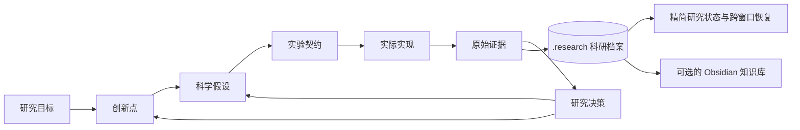

# ResearchLedger

[English](README.md) | [简体中文](README.zh-CN.md)

**面向 Coding Agent 的创新驱动科研实验管理**

[](https://github.com/FaFaGPT/ResearchLedger/actions/workflows/tests.yml)
[下载 v0.1.0](https://github.com/FaFaGPT/ResearchLedger/releases/tag/v0.1.0)

当实验、代码变更和对话不断积累时，仍然清楚地知道：我们在解决什么科学问题，尝试过哪些路线，哪些结论有证据支持，下一步应该做什么。

ResearchLedger 是一个可直接使用的 **Codex Skill**，同时提供**无第三方运行时依赖的 Python CLI**。它将科研创新点、实验契约、实际实现、原始证据和研究决策串联起来，并通过持久化记忆保持跨对话的科研连续性。

**以创新点组织实验，以证据验证结论，以 Obsidian 沉淀知识，以持久化记忆维持科研连续性。**

六个核心特征：**创新驱动 · 证据可追溯 · 方法透明 · 研究边界可检查 · 上下文精简 · 知识互联**。



## V1 已实现的功能

- **创新点管理**：支持研究者预设、研究者后续提出、AI 提出的三类创新点；记录稳定 ID 和完整修订历史，支持批准、暂停、否决、拆分、替代及主创新方向调整。
- **实验契约**：校验实验配置，固定源码与配置文件的具体内容，记录配对对照、资源预算、可执行停止条件，并检查重复实验。
- **方法溯源**：显式执行实验时，采集 Git 状态、源码与配置、Python 函数位置、日志、结果及已声明输入文件的代码差异。
- **分层判断**：分别记录运行成功、指标改善、达到验收标准、通过结构性检查和研究者形成科学结论。
- **证据与偏离审计**：检查未授权文件变更、配置与结果报告不一致、不公平对比，以及对已声明创新点约束的偏离。
- **科研记忆**：采用追加式记录、哈希链和不可变的 SHA-256 证据文件；新对话可以从账本重建精简的研究状态。
- **受控探索**：支持 Strict、Bounded 和有预算限制的 Explore 模式；探索性结果不能直接晋升为正式确认性结论。
- **可选 Obsidian 集成**：生成 Dashboard、Properties、原生 Bases 表格和关系链接，关联已有文献笔记，并支持候选想法导入。
- **安全增量同步**：通过导出清单与内容哈希检测冲突，支持中断后重试，保护人工笔记。

**不强制依赖 Obsidian、MLflow、W&B 或 DVC。** ResearchLedger 在现有实验跟踪工具之上补充科学意图、研究边界和决策管理。参见[调研与设计依据](docs/RESEARCH.md)和[适配器边界](docs/ADAPTERS.md)。

## 安装

要求 Python 3.8 及以上版本；新环境建议使用仍受维护的 Python 版本。建议安装 Git 以记录代码溯源；Explore 模式的分支检查需要 Git。核心功能没有需要额外下载的第三方 Python 运行时依赖。

### 安装为 Codex Skill

从[公开仓库](https://github.com/FaFaGPT/ResearchLedger)获取源码：

```bash
git clone https://github.com/FaFaGPT/ResearchLedger.git
cd ResearchLedger
```

在仓库目录中执行，将 Skill 安装到指定科研项目：

```bash
python tools/install_skill.py --destination /path/to/project/.agents/skills
```

Windows PowerShell 示例：

```powershell
python tools/install_skill.py --destination "D:/Research/MyProject/.agents/skills"
```

安装器会创建 `researchledger/` 目录；如果已有同名安装，则拒绝覆盖。若希望个人使用，可以指定用户级 Skill 目录，例如 `~/.agents/skills`。部分 Codex 发行环境也使用 `$CODEX_HOME/skills`，请以当前环境实际识别的位置为准。安装器不会修改全局设置或 `AGENTS.md`。参见 [Codex 官方 Skill 发现机制文档](https://developers.openai.com/codex/skills)。

安装后，在 Codex 中自然语言调用：

```text
使用 $researchledger 恢复这个项目的科研状态，列出哪些创新点已有证据、
哪些路线失败过，并在我已批准的研究范围内规划下一个实验。
```

也可以提出具体请求：

```text
使用 $researchledger 审计这个实验，检查实际算法、数据和评价指标
是否符合实验契约，并区分指标改善与科学假设得到支持。
```

### 使用命令行

无需安装 Python 包，直接运行：

```bash
python skills/researchledger/scripts/ledger.py --help
```

也可以在当前 Python 环境中安装：

```bash
python -m pip install .
researchledger --help
```

CLI 与独立 Skill 使用同一份源码。全局参数 `--project`、`--actor`、`--details` 必须放在**子命令之前**。

## 一条命令运行真实示例

```bash
python tools/build_demo.py --output /path/to/new-demo
```

这条命令会创建新项目，并实际运行一个小型、仅使用 CPU 的鲁棒估计实验：在相同的受离群点污染的样本上，比较中位数与均值的估计误差。随后生成失败和创新点漂移案例，保存证据与研究检查点，并导出 Obsidian Vault。

目标目录必须尚不存在。示例不会进行高成本训练；它用于展示实验管理与审计流程，不声称产生了新的科学发现。

仓库已包含运行完成的[示例项目](examples/demo/)和 [Obsidian 示例 Vault](examples/demo/vault/)。在 Obsidian 中打开该 Vault，然后进入 `ResearchLedger-Demo/Dashboard.md`。[使用案例](docs/USE_CASES.md)说明了成功、失败、漂移和跨窗口恢复流程。示例中的指标与证据来自实际运行。

## 五个核心命令

| 命令 | 用途 | 是否写入数据 |
| --- | --- | --- |
| `status` | 查看研究目标、创新点、关键结果和未解决问题 | 否 |
| `plan contract.json` | 校验并登记科学假设与固定输入的实验契约 | 是 |
| `audit EXP-ID` | 检查证据、对比公平性、实验偏离和创新点漂移 | 默认只读；加 `--save` 追加审计记录 |
| `history TERM-OR-ID` | 检索历史修订；使用全局参数 `--details` 展开记录 | 否 |
| `resume` | 从账本重建精简的研究状态 | 否 |

`run EXP-ID` **只做执行前检查**。只有 `run EXP-ID --execute` 才会启动已获授权的实验命令。`status`、`resume` 和 Obsidian 同步都不会自动运行实验。

### 典型工作流

下面各行前面均需加上 `researchledger --project PROJECT`，其中 `PROJECT` 是科研项目目录；也可以使用 Skill 自带的 `ledger.py` 入口：

```text
init "降低稀疏离群点污染下的估计误差"
--actor researcher innovation add innovation.json
--actor researcher innovation approve INN-ID --reason "研究者已批准该研究方向"
plan contract.json
--actor researcher approve EXP-ID --reason "已批准命令、修改范围和 10 秒执行预算"
run EXP-ID
run EXP-ID --execute
audit EXP-ID
--details history EXP-ID
--actor researcher decision EXP-ID Supported --reason "证据支持该限定范围内的假设" --review review.md
resume
```

请使用创建命令返回的真实 ID 替换 `INN-ID` 和 `EXP-ID`。可从[实验契约模板](skills/researchledger/assets/contract.json)和[创新点示例](examples/robust-location/innovation.json)开始填写。[工作流与数据结构参考](skills/researchledger/references/workflow.md)说明了各字段和状态变化。

`--actor researcher` 用于记录**已经从研究者处获得的授权**，并不是身份认证机制。AI 不得通过设置这个参数给自己授权。Skill 对此规定了操作流程；拥有本地项目写权限的人仍然能够绕过本地软件控制。

## 如何判断证据与结论

实验程序通过独立的 `RESEARCHLEDGER_RESULT` 路径，输出实际配置 `observed` 和成对的基线/实验组记录 `trials`。执行器保存输出的原始字节。[审计协议](skills/researchledger/references/audit.md)描述了具体格式。

| 观察到的事实 | 能说明什么 |
| --- | --- |
| 进程正常退出 | 本次程序执行成功 |
| 配对指标的均值改善 | 报告中的这组对比出现数值提升 |
| 审计状态为 `Completed` | 已实现的结构性检查通过 |
| 研究者审查并接受证据 | 可以针对限定范围内的假设记录 `Supported` 或 `Refuted` 决策 |

四种审计结果：

- **Completed**：执行成功，且已实现的结构性检查通过。
- **Failed**：运行失败，例如非零退出、超时或超出输出预算。
- **Deviated**：发现未授权变更、不公平对比或创新点约束偏离。
- **Unverified**：证据缺失、不完整、格式无效或完整性验证失败。

如果同时发现偏离和运行失败，状态优先标记为 `Deviated`，同时分别保留实际执行情况。无法确认的事实保持为 **Unknown**。正式科学结论需要通过验证的确认性审计，以及保存了原始内容的研究者审查文件；实验结果不会自动变成科学结论。

## 可选的 Obsidian 集成

```bash
researchledger --project PROJECT obsidian init /path/to/vault
researchledger --project PROJECT obsidian status
researchledger --project PROJECT obsidian sync
```

导出目录包含 Dashboard、Innovations、Experiments、Methods、Evidence、Decisions、Literature 和 Research State，并通过基于稳定 ID 的双向链接连接。`Research.base` 提供原生筛选表格视图；Obsidian Graph View 使用同一套关系链接。

可以直接关联已有文献笔记，不需要迁移其位置。以下命令同样需加上 `researchledger --project PROJECT` 前缀：

```text
literature "鲁棒统计文献" "note:Reading/Robust Statistics.md" --innovations INN-ID
obsidian candidate Ideas/New-method.md
```

导入的想法进入 `PendingReview` 候选状态，不能覆盖正式记录。手动编辑生成笔记后，同步会检测到冲突并停止覆盖。建议将个人批注写在独立笔记中，再链接到生成记录。同步不会删除笔记，也不提供强制覆盖选项。参见[同步机制与保障](skills/researchledger/references/obsidian.md)。

## 持久化与能力边界

```text
project/
  .research/
    events.jsonl       # 追加式完整记录修订及哈希链
    blobs/<sha256>     # 采集后不可变的原始证据
    runs/<run-ID>/     # 每次执行独立的原始输出目录
    state.json         # 从账本生成的精简状态缓存
    STATE.md           # 从账本生成的可读科研记忆
```

`.research/` 中的账本是唯一正式数据来源。Obsidian 是展示视图；读取研究状态时不会将缓存作为权威依据。备份时应完整备份 `.research/`。若日志损坏或被截断，系统会拒绝继续读取，不会静默修复、删除或重写历史。

V1 是一个**面向协作场景的本地实验执行控制器**。它约束实际运行时间和采集输出的大小，记录工作区变更，并检查预先声明的科学约束。它不是用于隔离恶意代码的安全沙箱：不会硬性限制 GPU、内存、费用或网络，也无法阻止所有外部副作用、认证用户身份，或证明程序实际使用了它所报告的配置。某些平台上的脱离进程组的子进程可能逃过进程树清理。需要更强隔离时，应配合操作系统、容器或作业调度器。

工作区快照上限为 **256 MiB / 20,000 个文件**，排除 `.git`、`.research`、`.venv`、`node_modules` 和 `__pycache__`。每个已声明输入文件最多 **16 MiB**。大型项目建议使用专门的小型实验工作树，并通过经过审查的数据清单关联大规模数据。只有明确声明的源码和配置输入会保存完整字节；其他文件通过内容哈希检测变更。环境采集记录 Python、平台信息和明确列出的依赖锁定文件，不会生成整台机器的环境镜像。

当前创新点漂移检测依据已声明的约束字段，以及文件、配置和结果报告检查。任意算法的语义、统计有效性、数据泄漏和真正的可复现性仍需要审查，并在适当情况下进行独立复现实验。Method Card 会明确显示这些限制。参见[安全边界](SECURITY.md)。

## 开发与验证

```bash
python -m unittest discover -s tests -v
python tools/release_check.py
```

测试会运行真实子进程，覆盖成功与失败、证据损坏、未授权修改、创新点漂移、研究恢复、探索预算、路径安全，以及 Obsidian 中断恢复与幂等同步。仓库包含 Windows/Linux CI。参见[测试报告](docs/TEST_REPORT.md)、[系统架构](docs/ARCHITECTURE.md)和[实现进度](IMPLEMENTATION_STATUS.md)。

采用 MIT 许可证。贡献代码或文档时，请持续区分**采集到的证据、结构性审计结果和科学解释**。
