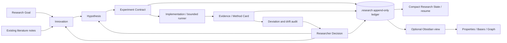

# Architecture

The archive consists of hash-chained JSONL transactions and immutable evidence blobs. A write lock serializes mutations, including a running experiment. Transactions carry complete record revisions, so replay does not depend on executable migrations or hidden patches. Derived caches are never trusted by read commands. A truncated or corrupt journal fails closed and requires restoration from a verified backup; no automatic destructive repair occurs.

The model is Goal → Innovation → Hypothesis → Experiment → Run → Evidence → Audit → Decision. Every record has a stable ID, kind, version, UTC creation/update times, source and evidence references. Innovations retain revisions and evolution links. Contracts pin innovation and hypothesis versions. Changes revoke approvals. Confirmatory results require a clean audit and researcher review before a support/reject decision can update the scientific state.

Obsidian sync produces deterministic bytes. A separate ledger event stores the previous exported hashes. A generated file can be changed only if its current hash still matches that manifest. Existing files are never adopted merely because their names match. Exports use a dedicated project namespace, safe relative paths and symlink checks. Sync preflights all conflicts before changing any file; interrupted updates can be retried without accepting arbitrary edits.
